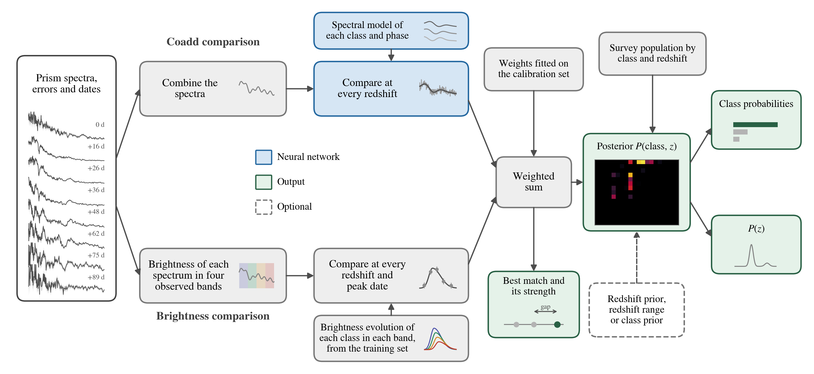

STRIDER
=======

.. what-strider-does

**STRIDER** identifies transients from their Roman prism spectra. For each transient it gives the probability of
each class, the redshift with its range, and how clearly the best match beats the others.

.. end-what-strider-does

STRIDER is in active development: its models and outputs may change between versions.

         four bands over time; the two comparisons are added, then weighted by how common each class is.

STRIDER compares the visits' combined spectrum with each class at every redshift, and each visit's brightness in
four bands with each class's light curves. It adds the two, then weights the result by how common each class is.

In and out
----------

- **In:** each visit's date (MJD), wavelengths (Å), flux and its error, as a CSV or Parquet file, an astropy or
  pandas table, or Roman SMDC files. Optionally, a host redshift, a redshift range or the classes to allow.
- **Out:** the probability of each of 15 classes, the redshift with its 68% range, how strong the match is and any
  warnings, as a printed card, a Parquet, CSV or JSON file, and a figure.

Install
-------

.. code-block:: console

    git clone https://github.com/Roman-Supernova-PIT/strider.git && cd strider
    pip install torch --index-url https://download.pytorch.org/whl/cpu
    pip install .

Example
-------

.. code-block:: python

    import strider

    model = strider.load_model()  # downloads the model the first time
    result = model.classify(strider.load_example())
    print(result)
    result.plot("example.png")

.. code-block:: text

    STRIDER · transient                                         strider-15class-1.0
    Class     Ia 100%
    Redshift  0.869 (100% within 0.1) · 68% range 0.864–0.873
    Match     high strength
    Data      11 visits over 100 days · S/N 4.8

The example is a simulated SN Ia at redshift 0.868. For your own transient, make a CSV file with one row per pixel
and the columns ``mjd``, ``wavelength``, ``flux`` and ``error``, then run:

.. code-block:: console

    strider classify my_transient.csv

`Documentation <https://roman-supernova-pit.github.io/strider/>`_ ·
`How it works <https://roman-supernova-pit.github.io/strider/how_it_works.html>`_ ·
`Tutorial <https://github.com/Roman-Supernova-PIT/strider/blob/main/docs/tutorial.ipynb>`_ ·
`Issues <https://github.com/Roman-Supernova-PIT/strider/issues>`_ · Cite Dixon et al. (in prep.) · BSD 3-Clause
licence · By the Roman Supernova Project Infrastructure Team
