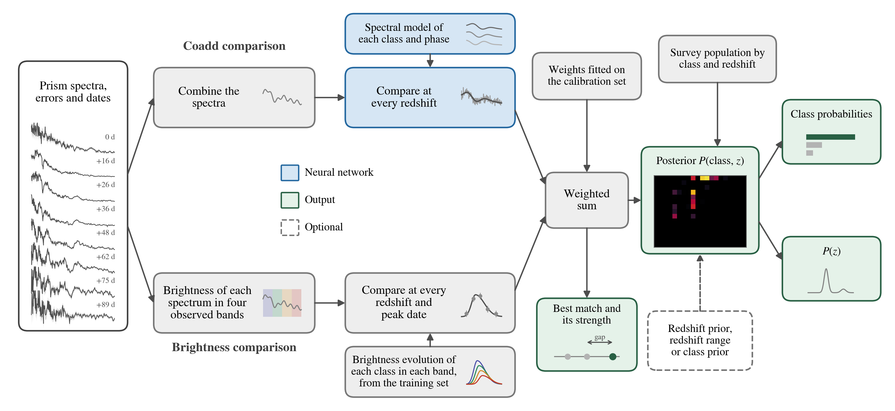

How STRIDER works
=================

         gives the best match and its strength and, with the survey population and any prior you give, the posterior
         over class and redshift.

What goes in
------------

For each transient, its prism spectra: for each visit, the date (MJD), the wavelengths, the flux and its error.
You can also give a redshift prior (for example a host-galaxy redshift), a redshift range, or class priors.

Two comparisons
---------------

**Coadd comparison.** STRIDER combines the visits into one spectrum and compares it with what each class looks like
at every redshift. This comparison was learned from simulated Roman spectra.

**Brightness comparison.** STRIDER sums each visit's spectrum into four fixed bands between 7,500 and 18,000 Å, and
compares how the four bands brighten and fade with each class, at every redshift and every peak date. The class
light curves come from the training simulations. Each band's steady level is removed, so light that stays the same
from visit to visit, such as steady light from the host galaxy, does not count. Spectra from a single date add
nothing here; it counts from the second date.

The two look at the same data in two ways. The coadd comparison sees the detailed shape of the spectrum. The
brightness comparison sees colour and how it changes with time, which tells which of the spectral matches belongs to
the transient, and often its redshift.

Putting them together
---------------------

STRIDER adds the two comparisons with two fixed weights. It then applies how common each class is at each redshift
among the transients Roman is expected to find, and any prior you gave. The result is the probability of every class at every redshift.

What comes out
--------------

- The probability of each class, and of a type Ia supernova.
- The redshift, its 68% range, and a second redshift when there is one.
- Checks: the number of redshift peaks, the source probability (the chance the spectra hold a transient at all) and
  flags.
- The best match: the class and redshift that fit best before the class mix is applied, how far ahead of the next
  class it is (the match gap, not a probability), its strength (high, medium or low), and warnings when a second
  redshift fits nearly as well or the two comparisons disagree.

:doc:`results` explains each of these.

What it does not do
-------------------

STRIDER does not estimate the phase or age of a transient, and it takes no peak date: the brightness comparison
searches every peak date itself. It uses the prism spectra only, not Roman's imaging.
